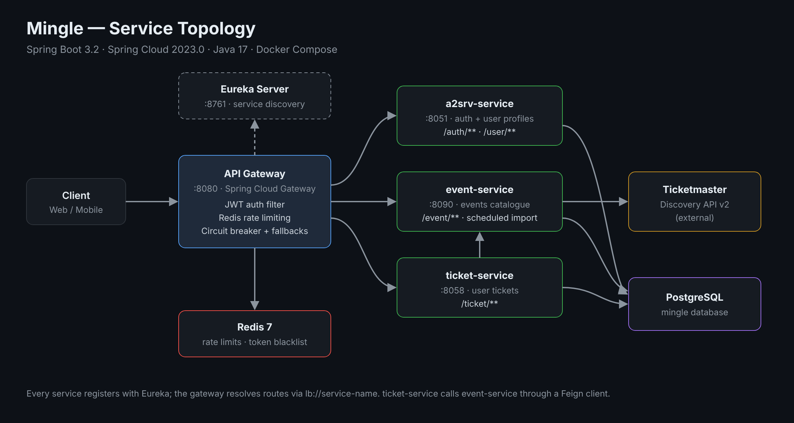
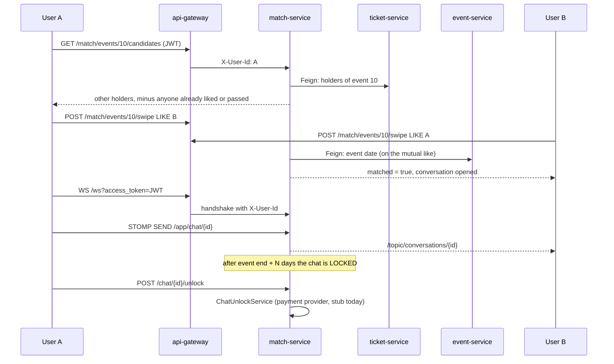

<div align="center">

# Mingle

**An event-centred social platform built as Spring Cloud microservices.**

Find events, get tickets, and meet people who are going to the same place.

[](https://github.com/codevivus/mingle/actions/workflows/ci.yml)


</div>

---

## Architecture

<p align="center">
  
</p>

| Service | Port | Responsibility |
|---|---|---|
| `eureka-server` | 8761 | Service discovery (Netflix Eureka) |
| `api-gateway` | 8080 | Single entry point: routing, JWT validation, token blacklist |
| `a2srv-service` | 8051 | Authentication and user profiles |
| `event-service` | 8090 | Event catalogue, imported on a schedule from the Ticketmaster Discovery API |
| `ticket-service` | 8058 | Users' tickets for events (calls `event-service` via Feign); each user only sees their own |
| `match-service` | 8095 | Per-event matching (candidates, swipes, matches) and real-time chat (REST + STOMP over WebSocket) |
| `postgres` | — | Shared PostgreSQL 16 database |
| `redis` | — | Revoked-token blacklist |

All services register with Eureka, and the gateway forwards traffic with `lb://<service-name>` load-balanced routes defined in [`api-gateway/src/main/resources/authorization.yaml`](api-gateway/src/main/resources/authorization.yaml).

## Features

- **Gateway security** — a global JWT filter validates tokens against `a2srv-service`; public paths (login, registration, health, API docs) are whitelisted.
- **Token lifecycle** — access and refresh tokens, logout with server-side token blacklisting.
- **User profiles** — registration with email / username availability checks, profile and password updates, and search by city, age range, gender, goal, date preference, online status, recency, verification and proximity.
- **Events** — CRUD and listing, city list, manual import trigger, nightly Ticketmaster import (03:00) and cleanup of expired events (04:00).
- **Tickets** — create, delete and list your own tickets. The owner always comes from the `X-User-Id` header the gateway sets; a `userId` in the request body is ignored.
- **Email verification** — registration mails a one-time link (valid 24 h, stored hashed). Until it is used the account can log in but cannot add tickets or match (`403`). In development the mail goes to MailHog at <http://localhost:8025>; for a real provider set `SMTP_HOST`, `SMTP_PORT`, `SMTP_USERNAME`, `SMTP_PASSWORD`, `SMTP_AUTH`, `SMTP_STARTTLS`, `MAIL_FROM` and `APP_PUBLIC_URL`.
- **Roles** — users are `USER` or `ADMIN`. Creating, updating, deleting and importing events is admin only; the gateway forwards the role as `X-User-Role`.
- **Matching** — people holding a ticket to the same event see each other as candidates, can LIKE or PASS, and a mutual LIKE creates one match for that event.
- **Your data** — `GET /user/me/export` returns everything stored about the caller; `DELETE /user/me` (password required) removes the account, tickets, matches, conversations, swipes and blocks, and blacklists the token. Other services expose `/internal/users/{id}` for this, guarded by the shared `INTERNAL_API_KEY` (also now required by ticket-service and match-service).
- **Safety** — block a user (hides both from each other, ends their matches and closes the conversations for good), unmatch, and report with a reason; admins list and resolve open reports. A blocked pair looks like unknown users to each other (404 on swipe).
- **Chat** — each match gets a conversation: REST history and sending, plus real-time delivery over STOMP/WebSocket. Sending stops `CHAT_LOCK_AFTER_HOURS` (default 24) after the event ends (status `READ_ONLY`, `423` on send); the history stays readable for `CHAT_READ_ONLY_DAYS` (default 30) more, then the chat is `LOCKED` (`423` on read too). A locked chat is reopened through `POST /chat/{id}/unlock`, which calls a provider-agnostic `ChatUnlockService` (a stub that grants every unlock until a payment provider is chosen).
- **Resilience** — per-user (or per-IP) rate limiting with Redis and Resilience4j circuit breakers on the gateway routes, with a 503 fallback.
- **API documentation** — springdoc / Swagger UI on every service.
- **Observability** — Spring Boot Actuator health endpoints, used by Docker Compose health checks.

## API Overview

All requests go through the gateway at `http://localhost:8080`.

| Area | Endpoints |
|---|---|
| Auth | `POST /auth/login` · `POST /auth/refresh` · `POST /auth/logout` · `POST /auth/validate` · `GET /auth/verify?token=` · `POST /auth/resend-verification` (`{"email": ...}`) |
| Users | `POST /user/register` · `GET /user/check-email` · `GET /user/check-username` · `GET/PUT /user/me` · `PUT /user/password` · `GET /user/search/*` |
| Events | `GET/POST /event` · `GET/PUT/DELETE /event/{id}` · `GET /event/cities` · `POST /event/import` |
| Tickets | `POST /ticket/add` · `GET /ticket` · `GET/DELETE /ticket/{id}` · `GET /ticket/user/{userId}` · `GET /ticket/event/{eventId}` (all limited to the caller's own tickets) |
| Matching | `GET /match/events/{eventId}/candidates[?limit=50]` (name, age, city, photo included) · `POST /match/events/{eventId}/swipe` (`{"targetUserId": 2, "action": "LIKE"}`) · `GET /match/matches[?eventId=]` |
| Account | `GET /user/me/export` (everything stored about you, JSON) · `DELETE /user/me` (`{"password": "..."}` erases the account and the data in ticket-service and match-service; reports about you stay for moderation) |
| Safety | `POST /match/blocks/{userId}` · `DELETE /match/blocks/{userId}` · `GET /match/blocks` · `DELETE /match/matches/{id}` (unmatch) · `POST /match/reports` (`{"reportedUserId", "reason", "note", "block"}`) · admin: `GET /match/admin/reports` · `POST /match/admin/reports/{id}/resolve` |
| Chat | `GET /chat/unread-count` · `POST /chat/{id}/read` (`{"upToMessageId": 42}` optional) · · `GET /chat/{id}` · `GET /chat/{id}/messages?page=&size=` · `POST /chat/{id}/messages` · `POST /chat/{id}/unlock` (conversations carry `unreadCount`, `lastMessage` and `otherLastReadMessageId`) |
| WebSocket | STOMP at `ws://localhost:8080/ws?access_token=<jwt>` · send to `/app/chat/{id}` · subscribe to `/topic/conversations/{id}` · errors on `/user/queue/errors` |

Status codes worth knowing: `410` the conversation ended (block or unmatch), `403` not your ticket / not in that conversation / no ticket for the event, `423` chat is locked, `402` unlock needs payment, `429` rate limited, `503` service down (circuit breaker).

## Matching and chat flow



Swagger UI per service (local only): `http://localhost:<port>/swagger-ui.html`.

## Tech Stack

| Area | Technology |
|---|---|
| Language / framework | Java 17 · Spring Boot 3.2 · Spring Cloud 2023.0 |
| Edge | Spring Cloud Gateway (reactive) |
| Discovery | Netflix Eureka |
| Security | Spring Security · JJWT |
| Persistence | Spring Data JPA · PostgreSQL · Flyway (schema owned by migrations, Hibernate only validates) |
| Token blacklist | Redis 7 |
| Inter-service calls | OpenFeign |
| Mapping | MapStruct · Lombok |
| Docs | springdoc-openapi |
| Build / run | Maven · Docker Compose |

Each service follows the same package layout: `controller`, `service`, `repository`, `entity`, `dto`, `mapper`, `exception`, `validation`, `config`.

## Getting Started

### Prerequisites

- Docker and Docker Compose
- (Optional) A Ticketmaster API key for event imports

### Run

```bash
git clone https://github.com/codevivus/mingle.git
cd mingle

cp .env.example .env   # set JWT_SECRET and INTERNAL_API_KEY (and TICKETMASTER_API_KEY if you have one)
docker compose up -d --build
```

There is no admin by default. Register a user, then either set `ADMIN_EMAIL` to their email in `.env`, confirm the mailed link and restart (only a verified account is promoted at startup) or promote them once:

```bash
docker compose exec postgres psql -U mingle -d mingle -c "UPDATE users SET role = 'ADMIN' WHERE username = 'your-username';"
```

### End-to-end check

With the stack running, `node scripts/e2e.mjs` (Node 22+) registers two users, promotes one to admin, creates an event, adds tickets, matches them and sends a message over REST and STOMP through the gateway.

### Deploy

See [docs/DEPLOYMENT.md](docs/DEPLOYMENT.md): HTTPS with Caddy, closed ports, backups and the first-start checklist.

### Test

Each service has its own tests, which start PostgreSQL / Redis with Testcontainers, so Docker must be running:

```bash
cd match-service
./mvnw verify
```

GitHub Actions ([`.github/workflows/ci.yml`](.github/workflows/ci.yml)) builds and tests every service on each pull request.

Services start in dependency order (PostgreSQL / Redis → Eureka → Gateway → auth → event / ticket) using health checks. Only the gateway is published on all interfaces; the other service ports are bound to `127.0.0.1` for local debugging.

- Gateway: <http://localhost:8080>
- Eureka dashboard: <http://localhost:8761>

### Run a single service locally

```bash
cd event-service
./mvnw spring-boot:run
```

Configuration comes from environment variables, with local-development defaults in each service's `application.properties`. Copy `.env.example` to `.env` to set them for Docker Compose.

| Variable | Required | Default | Purpose |
|---|---|---|---|
| `JWT_SECRET` | yes | none | HMAC signing key, at least 32 characters (`openssl rand -base64 32`) |
| `INTERNAL_API_KEY` | yes | empty | Shared secret for service-to-service calls to the gateway's `/internal` endpoints |
| `DB_URL` | no | `jdbc:postgresql://localhost:5432/mingle` | PostgreSQL connection URL |
| `DB_USERNAME` / `DB_PASSWORD` | no | `mingle` / `mingle_local` | Database credentials (local development only) |
| `REDIS_HOST` / `REDIS_PASSWORD` | no | `localhost` / `mingle_local` | Redis connection |
| `TICKETMASTER_API_KEY` | no | empty | Enables the nightly Ticketmaster event import |
| `ADMIN_EMAIL` | no | empty | This registered account is promoted to `ADMIN` at startup (register it first) |
| `EVENT_TIME_ZONE` | no | `Europe/Istanbul` | Time zone used for event dates |
| `CHAT_LOCK_AFTER_HOURS` | no | `24` | Hours after an event before its chat locks |
| `CHAT_READ_ONLY_DAYS` | no | `30` | Days a locked chat stays readable |
| `CHAT_UNLOCK_PROVIDER` | no | `stub` | Payment provider for chat unlock; `stub` grants every unlock |
| `WS_ALLOWED_ORIGINS` | no | `https://localhost:4200,http://localhost:4200` | Allowed WebSocket origins |

---

## License

Copyright (c) 2026 Eren Yılmaz. All rights reserved. The source is publicly visible for evaluation only; see [`LICENSE`](LICENSE). To request permission to use any part of it, contact eerenyilmazz1@gmail.com.
